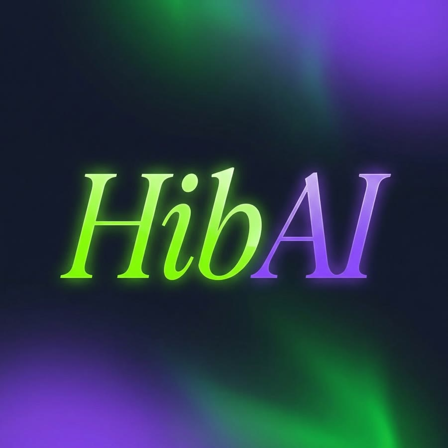

<p align="center">
  
</p>

<h1 align="center">HibAI Studio</h1>

<p align="center">
  <b>صيفط فيديو كتهضر فيه… وخود ريل واجد للنشر.</b><br>
  <i>Send a talking video, get back a reel that's ready to post.</i><br>
  A skill for Claude by <a href="https://instagram.com/hibssssi">Hiba · @hibssssi</a>
</p>

---

## مرحبا بيك ف HibAI 💚 · Welcome to HibAI

HibAI Studio is a Claude skill that edits your talking-to-camera videos for you:

- ✂️ **Cuts the pauses** and the lines you don't want
- 💬 **Word-by-word captions** in Darija, Arabic, English or French, with the word you're saying lit up
- 🔍 **Light punch-in zooms** so the cuts feel smooth
- 🎨 **HibAI colours** (or your own), hook headline, handle, closing line
- 🔊 **Loudness fixed** for Instagram / TikTok (-14 LUFS)
- 📝 Subtitles (`.srt`) + full text for your post caption

It starts with the **HibAI dashboard**: a short page that asks what you want (style,
pace, colours, hook…) before the edit begins.

## Install · كيفاش تنصبو

In Claude Code:

```
/plugin marketplace add HibaBenzahra/hibai-studio
/plugin install hibai-studio@hibai
```

Then send a video and say **"قاد ليا هاد الفيديو"** or **"edit my video"**.

**You need:** [ffmpeg](https://ffmpeg.org), Python 3.10+, and
`pip install openai-whisper`. Missing something? Claude checks and offers to install it.

## How it works

```
your video ─► HibAI dashboard ─► speech → text (word timing) ─► you fix / remove lines
          ─► pauses cut + zooms ─► captions burned in ─► loudness ─► final.mp4
```

Everything is one script, [`hibai.py`](skills/hibai-studio/scripts/hibai.py). Each step
saves plain JSON, so any step can be re-run alone.

## Make it yours · زيد عليه

The dashboard questions live in
[`dashboard/questions.js`](skills/hibai-studio/dashboard/questions.js). Add a block and
the dashboard shows it. See [`references/dashboard.md`](skills/hibai-studio/references/dashboard.md).

## Community

**تعلم واربح بالـ AI · Learn & Earn with AI** — join the HibAI community:
👉 **[societiz.com/communities/learn-earn-with-ai](https://societiz.com/communities/learn-earn-with-ai-262551)**

Follow along on Instagram → **[@hibssssi](https://instagram.com/hibssssi)**

## License

© 2026 Hiba Benzahra (HibAI). All rights reserved. You can install and use HibAI Studio
for your own videos. Sharing, reselling or publishing copies or modified versions needs
permission. See [LICENSE](LICENSE).

---

<p align="center"><sub>Made by Hiba · HibAI</sub></p>
