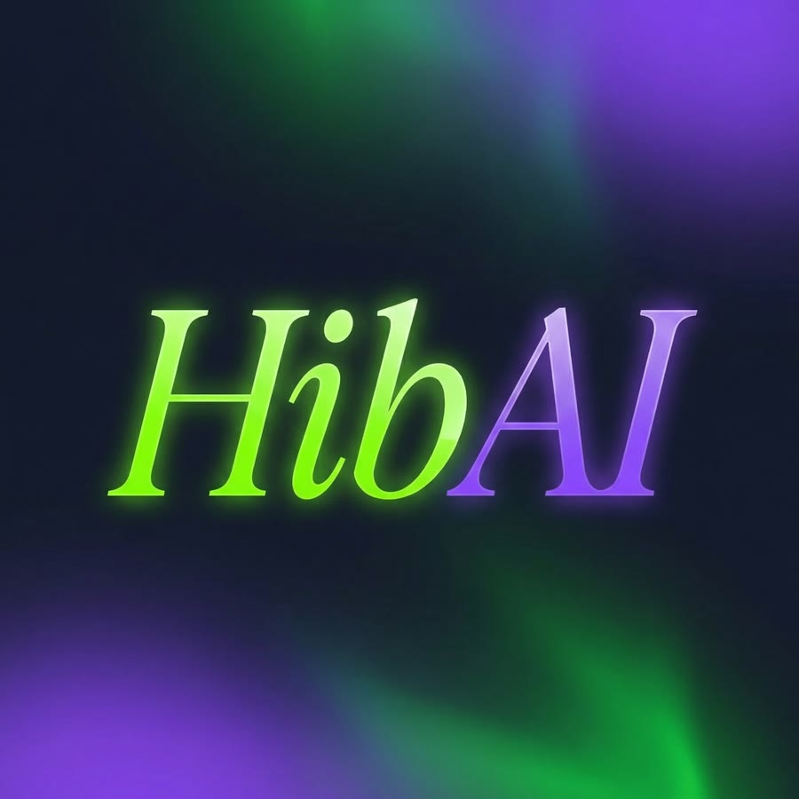
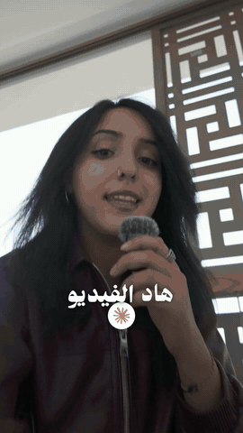
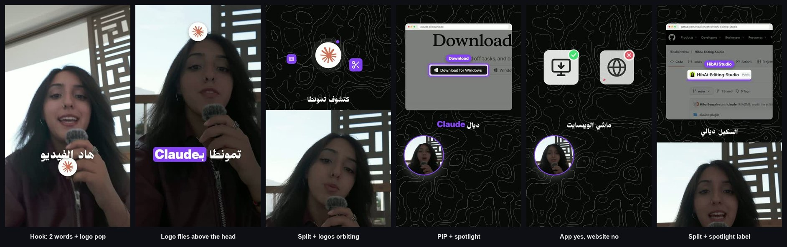
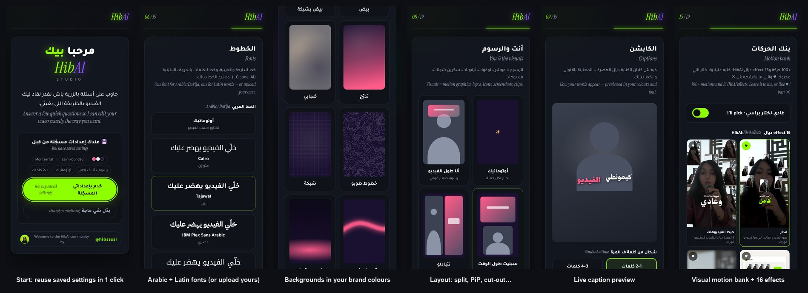
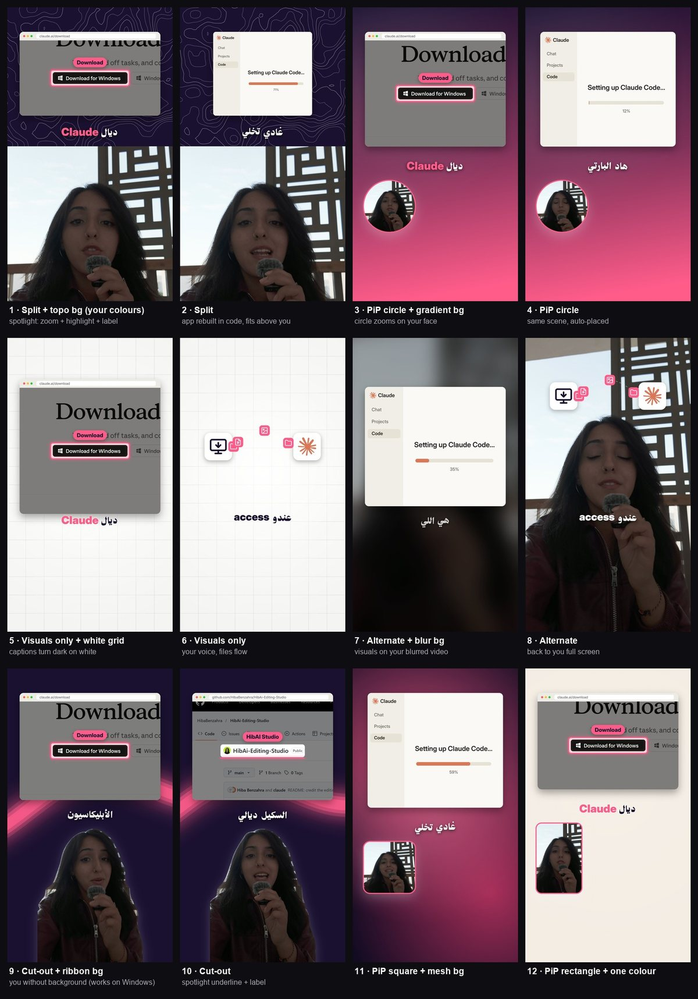

<p align="center">
  
</p>

<h1 align="center">HibAI Studio</h1>

<p align="center">
  <b>صيفط فيديو كتهضر فيه… وخود ريل واجد للنشر.</b><br>
  <i>Send a talking video, get back a reel that's ready to post.</i><br>
  A skill for Claude by <a href="https://instagram.com/hibssssi">Hiba · @hibssssi</a>
</p>

<p align="center">
  <br>
  <sub>A real edit made by the skill, no editing app. Captions in Darija + English, real logos and screenshots, all in the creator's colours.</sub><br>
  <b><a href=".github/readme/showcase.mp4">▶ Watch the full 22-second result (with sound)</a></b>
</p>

---

## مرحبا بيك ف HibAI 💚 · Welcome to HibAI

HibAI Studio is a Claude skill that edits your **talking-to-camera videos** into reels for Instagram and TikTok.
You talk, it does the rest: cuts, captions, motion graphics, real logos and interfaces, sound, in **your** brand.

<p align="center"></p>

## What it does

- ✂️ **Cuts the pauses** and the lines you don't want (retakes spotted for you)
- 💬 **Word-by-word captions** in Darija, Arabic, English or French, placed **just under your jaw**, never on your face.
  You choose **1–2 or 3–4 words** at a time. Latin words get a Latin font, Arabic/Darija an Arabic font.
- 🔤 **20+ fonts**: Arabic fonts (Zain, Lalezar, KO Mission, YR Speed, EYEN Ammon…) and 14 Latin fonts, or upload your own
- 🧩 **Real assets, not placeholders**: official brand logos, icons, screenshots of real websites, apps rebuilt in code,
  your own files first
- 🎥 **Auto framing**: full-screen shots zoom in gently so there's no empty space above your head
- 🔍 **Spotlight** on every screenshot and screen recording: zoom in, highlight, label, zoom back out
- 🎞️ **Pro motion**: a bank of 100+ moves, 17 styles, transitions, punch-ins and push-ins on you, depth moments
- 🖼️ **Layouts**: split screen, you ↔ visuals, visuals only, you in a **circle / square / frame**, or you **cut out**
  in front of the visuals, all with **animated backgrounds in your brand colours**
- 🛡️ **Safe zone checked** automatically: nothing hidden under Instagram/TikTok buttons or captions
- 🔊 **Sound**: optional audio clean-up, sound effects, loudness fixed for Instagram / TikTok (-14 LUFS)
- 📝 `.srt` subtitles + full text for your post caption, and an optional editable CapCut project
- 💻 Works on **Windows and macOS**

## The HibAI dashboard

Every new video starts with a page where you pick everything **visually**: colours, logo, fonts, backgrounds, layout,
captions (with a live preview), and the motions you like or never want. Fill it once, tick
**«save for my next videos»**, and next time it's **one click: «use my saved settings»**.

<p align="center"></p>

## Layouts and backgrounds

The same video, edited in each layout you can pick in the dashboard. The backgrounds are drawn live
in your brand colours (topo lines, gradient, grid, white grid, glow, ribbon, mesh, blur of your own video, your image…).

<p align="center"></p>

## You approve every step

1. **The script**: you see what will stay and what gets cut, before anything is edited
2. **The storyboard**: 6–12+ frames of the edit, so you can change a moment before it's rendered
3. **The final video**: 9:16, ready to post

No surprises, and no time spent rendering something you don't like.

## Install · كيفاش تنصبو

In Claude Code:

```
/plugin marketplace add HibaBenzahra/HibAi-Editing-Studio
/plugin install hibai-studio@hibai
```

Then send a video and say **"قاد ليا هاد الفيديو"** or **"edit my video"**.

**You need:** [ffmpeg](https://ffmpeg.org), Python 3.10+, [Node.js](https://nodejs.org) and Chrome or Edge.
Missing something? Claude checks and installs the rest for you (Whisper, OpenCV, yt-dlp, rembg…).

## Community

**تعلم واربح بالـ AI · Learn & Earn with AI** — join the HibAI community:
👉 **[societiz.com/communities/learn-earn-with-ai](https://societiz.com/communities/learn-earn-with-ai-262551)**

Follow along on Instagram → **[@hibssssi](https://instagram.com/hibssssi)**

## License

© 2026 Hiba Benzahra (HibAI). All rights reserved. You can install and use HibAI Studio
for your own videos. Sharing, reselling or publishing copies or modified versions needs
permission. See [LICENSE](LICENSE). Open-source parts keep their own licenses: see [THIRD_PARTY_NOTICES.txt](THIRD_PARTY_NOTICES.txt).
The bundled fonts are credited in [`skills/hibai-studio/motion/fonts/LICENSES.txt`](skills/hibai-studio/motion/fonts/LICENSES.txt).

## Credits · شكر

The editing engine is built on [video-ad-editor](https://github.com/majedphotos/video-ad-editor)
by **Majed Alzaabi**, used under the MIT License. Thank you Majed 🙏
شكراً لماجد على المحرك اللي بنينا عليه.

---

<p align="center"><sub>Made by Hiba · HibAI</sub></p>
